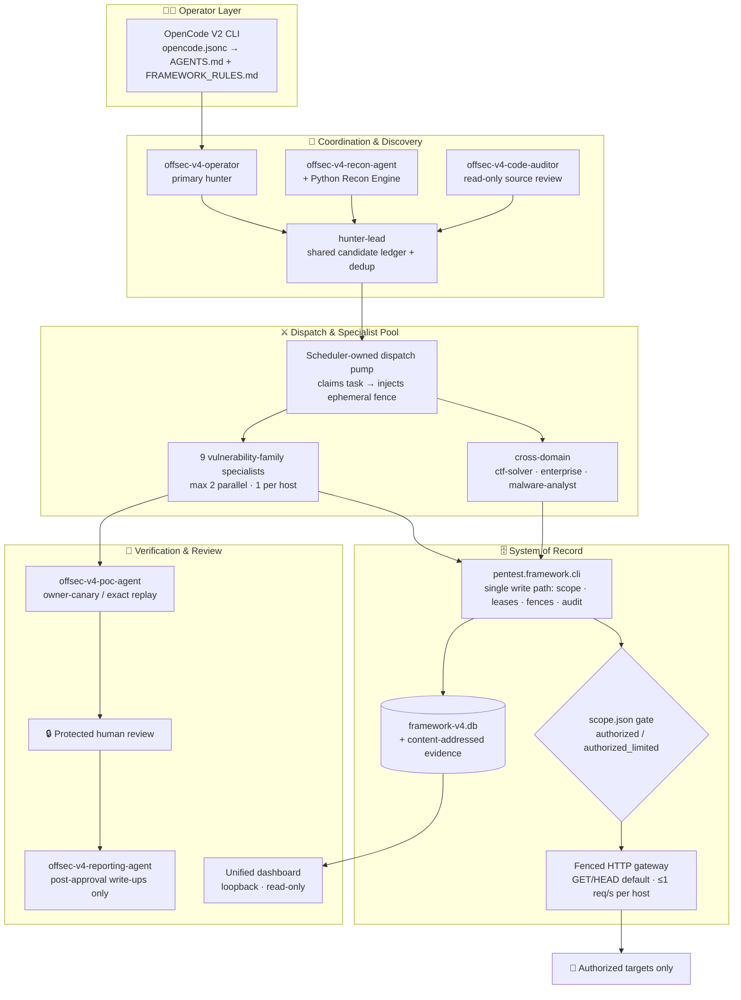
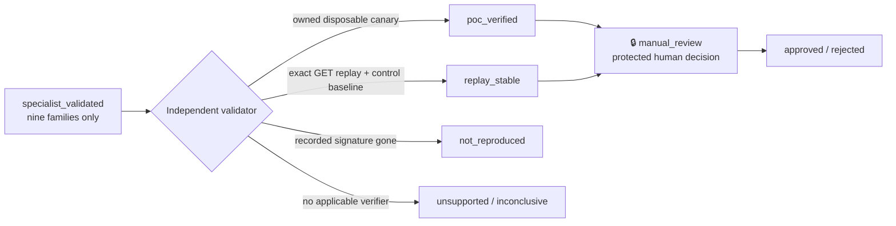

<div align="center">


<a href="https://github.com/Monesgoda/AgntX-Hunter">
  
</a>

[](RELEASE.json)
[](#-requirements)
[](https://opencode.ai)
[](#-quick-start)
[](LICENSE)

[](https://github.com/Monesgoda/AgntX-Hunter/stargazers)
[](https://github.com/Monesgoda/AgntX-Hunter/commits/main)
[](#-the-team)


**[About](#-what-is-agntx-hunter) • [Architecture](#-architecture) • [Agents](#-the-agent-roster) • [Verification](#-evidence--verification-pipeline) • [Install](#-installation) • [Usage](#-quick-start) • [Safety](#-authorization--safety-model) • [Team](#-the-team)**

</div>

> [!IMPORTANT]
> **AgntX-Hunter is an authorized-testing framework.** It ships with a *pending-authorization* demo scope, no credentials, no targets and no populated databases. Nothing runs against any system until an engagement with explicit written authorization is enrolled in `pentest/scope.json`. See the [Safety Model](#-authorization--safety-model) and [Legal Disclaimer](#-legal-disclaimer).

---

## 🎯 What is AgntX-Hunter?

**AgntX-Hunter** is the public home of **BP5** — a lean, installable **offensive-security agent framework** that runs on top of the **OpenCode V2 CLI**. It orchestrates a disciplined team of **17 specialized AI agents** that hunt, route, validate and report vulnerabilities across **9 vulnerability families**, backed by **25 native skills** and a read-only library of **155 technique playbooks**.

This is not a "prompt and pray" scanner. Every state change flows through one audited CLI, every outbound request passes a scope-fenced gateway, every finding needs independent evidence — and **a protected human review is always the final gate**.

| | |
|---|---|
| **Package ID** | `opencode-offsec-merged` |
| **Release** | `4.6.4-merged.6-runtime-patch4-lean` |
| **Flavor** | Runtime-only (no keys, no data, no tests, no session history) |
| **Main role** | `offsec-v4-operator` |
| **Registry** | [`pentest/agents/v4-index.json`](pentest/agents/v4-index.json) |
| **System of record** | `pentest/framework-v4.db` + content-addressed evidence |

### ✨ Highlights

- 🧭 **Coordinated hunting** — the operator investigates live while Recon runs in the background; candidates are deduped through a shared `hunter-lead` ledger.
- ⚔️ **Nine family specialists** — injection, client-side, access-auth, request-forgery, file-path, business-logic, infra, API and LLM-security — the *only* roles allowed to create confirmed findings.
- 🧪 **Cross-domain units** — CTF solver, enterprise (network / AD / cloud / container) and malware-analysis agents.
- 🔬 **Two-tier independent validation** — owner-controlled disposable canaries (`poc_verified`) or exact fenced replay with a control baseline (`replay_stable`). Neither auto-approves anything.
- 🛡️ **Fail-closed scope enforcement** — host, port, scheme, DNS, TLS and *exact-endpoint* rules intersect; prompts can never widen them.
- 🗄️ **Single write path** — all state changes go through `python -m pentest.framework.cli` with scope, lease-fencing and audit checks. No direct SQLite writes by agents.
- 📦 **Preservation-first installer** — verified staging, external backups, coherent SQLite snapshots, rehearsed migrations and an `INSTALL_RECEIPT.json`.
- 🧩 **Dependency-free context plugin** — token-saving compaction notes with opt-in, byte-exact large-output capture.

---

## 🧠 Architecture



### The layers, explained

| Layer | What it does |
|---|---|
| **Contracts** | `opencode.jsonc` selects the main role and loads `AGENTS.md`; the installer adds `FRAMEWORK_RULES.md` to native instructions. Role names are stable because queued work depends on them. |
| **Coordination** | One scheduler owns the single dispatch pump. It claims a task *before* launching a worker and injects an ephemeral fence — workers must submit evidence while their task is running. |
| **Specialists** | Only the nine family specialists may create `specialist_validated` findings. Recon, Main, the code auditor and cross-domain roles route candidates through `hunter-lead`. |
| **Gateway** | The pinned HTTP gateway checks the actual method before DNS/TLS/connection work. GET/HEAD by default; mutating verbs require explicit per-engagement opt-in **and** staged execution. |
| **Storage** | `pentest/framework-v4.db` plus content-addressed evidence is the system of record. The CLI is the only writer. |
| **Review** | The tokenless loopback dashboard is for *viewing*. Approval happens only in the protected reviewer workflow. Reporting runs strictly after approval. |

### Execution budgets (defaults)

| Knob | Value |
|---|---|
| Recon batch size | 25 targets |
| Strict per-target time | 15 s |
| Batch window | 240 s |
| Global parallel workers | 2 |
| Per-host parallel workers | 1 |
| Gateway pacing | ≤ 1 request / second / host |

### Two native layouts — never both

| Layout | Agents | Skills |
|---|---|---|
| **project** | `.opencode/agents` | `.opencode/skills` |
| **global-flat** | `agents/` | `skills/` |

---

## 🤖 The Agent Roster

All **17 agents**, straight from [`pentest/agents/v4-index.json`](pentest/agents/v4-index.json):

| Layer | Agent | Mission |
|---|---|---|
| 🧭 Coordination | `offsec-v4-operator` | Primary hunter & coordinator; submits candidates via `hunter-lead` |
| 📡 Discovery | `offsec-v4-recon-agent` | Artifact analyst alongside the Python Recon Engine |
| 💉 Specialist | `offsec-family-injection` | SQL/NoSQL/command/XXE/SSTI/LDAP/CSV/CRLF/header injection & deserialization |
| 🕸️ Specialist | `offsec-family-client-side` | XSS (reflected/stored/DOM/blind), DOM clobbering, prototype pollution, postMessage, CSP, clickjacking |
| 🔑 Specialist | `offsec-family-access-auth` | IDOR/BOLA/BFLA, privilege escalation, mass assignment, auth/2FA bypass, JWT/OAuth/SAML |
| 🔀 Specialist | `offsec-family-request-forgery` | CSRF, SSRF, DNS rebinding, distinct-root-cause XXE impacts |
| 📂 Specialist | `offsec-family-file-path` | Uploads, path traversal, LFI/RFI, Zip Slip |
| 🧮 Specialist | `offsec-family-business-logic` | Race conditions, workflow confusion, logic authorization, price/parameter abuse |
| 🏗️ Specialist | `offsec-family-infra` | Cloud/storage exposure, host headers, CI/CD & supply chain, smuggling, cache, CORS/headers |
| 🔌 Specialist | `offsec-family-api` | GraphQL, resource limits, unsafe upstream APIs, old versions, OpenAPI/REST inventory |
| 🧠 Specialist | `offsec-family-llm-security` | Prompt injection, sensitive-data disclosure, excessive tool agency, unsafe output handling |
| 🔬 Verification | `offsec-v4-poc-agent` | Independent owner-canary & exact-replay validation |
| 📖 Code review | `offsec-v4-code-auditor` | Opt-in read-only source audit; sends *unverified* leads to specialists |
| 🚩 Cross-domain | `offsec-v4-ctf-solver` | CTF challenge analysis |
| 🏢 Cross-domain | `offsec-v4-enterprise` | Enterprise network / AD / cloud / container review |
| 🦠 Cross-domain | `offsec-v4-malware-analyst` | Malware analysis |
| 📝 Reporting | `offsec-v4-reporting-agent` | Drafts submission write-ups from stored facts — **after** approval only |

---

## 🔬 Evidence & Verification Pipeline



| Tier | Meaning | Strength |
|---|---|---|
| `poc_verified` | An independently enrolled, **owner-controlled disposable canary** was reached, confirmed by an independent gateway fetch | Strongest |
| `replay_stable` | The independent fenced gateway re-fetched the **exact** recorded target + control GET transactions and reproduced the same HTTP signature | Objective, but a repeated signature — *not* semantic exploit proof |
| `not_reproduced` | The recorded signature objectively no longer appears | Not proof a bug is fixed |
| `unsupported` / `inconclusive` | No validator applies / no objective result possible | Honestly labeled, never dressed up |

> [!NOTE]
> No validation outcome auto-approves a finding. Missing, pending or running independent work never qualifies for final approval — **protected human review is mandatory**.

---

## 📁 Repository Layout

```text
AgntX-Hunter/
├── BP5_AGENT_RUNTIME.zip            # Lean installable runtime (SHA-256 pinned below)
├── INSTALL.py                       # Preservation-first installer: plan → apply → receipt
├── INSTALL_PROMPT.md                # AI-assisted installation contract
├── SETUP_V4.py                      # Setup helper (preserves native settings)
├── START.py                         # Launcher + read-only --check diagnostics
├── START_DASHBOARD.ps1              # Unified review dashboard (loopback, Windows)
├── V4_RUN_ENGAGEMENT.ps1            # Optional Windows engagement runner
├── VERIFY_PUBLIC_RELEASE.py         # strict / installed integrity verification
├── PUBLIC_FILE_SHA256_MANIFEST.json # Per-file SHA-256 manifest
├── RELEASE.json                     # Release metadata & expected role/skill counts
├── AGENTS.md                        # Operating contract: roles, evidence, gateway
├── FRAMEWORK_RULES.md               # Native instruction rules
├── SECURITY_NOTES.md                # Deployment boundary & known limits
├── README_PUBLIC_RELEASE.md         # Full operating guide
├── THIRD_PARTY_NOTICE.md            # Imported references & provenance
├── opencode.jsonc                   # Native config: main role + contracts
├── token-saver.json                 # Context-plugin settings
├── pentest/
│   └── agents/v4-index.json         # Canonical 17-agent registry
└── legacy/skills-original/          # Read-only historical research references
```

*The installed root additionally receives the `pentest/framework` CLI package, skills, the context plugin and the runtime database location.*

---

## 📦 Requirements

| Requirement | Notes |
|---|---|
| **Python ≥ 3.10** | `python`, `py -3` (Windows) or `python3` (macOS/Linux) |
| **OpenCode V2 CLI** | Installed **separately**; native API baseline **2.3.2** |
| **Provider credentials** | Configured by the operator — never bundled or auto-installed |
| **OS** | Windows first-class (PowerShell helpers); other platforms need their own validation |
| **External Recon tools** | Optional, not bundled; require explicit per-engagement opt-in |

---

## 🚀 Installation

**Expected archive SHA-256** (`BP5_AGENT_RUNTIME.zip`):

```text
8e24716013c190af0e11bb9577c6e59dff5e346fb2bd82fe6879414dbbecd53c
```

### Path A — AI-assisted (recommended)

Hand [`INSTALL_PROMPT.md`](INSTALL_PROMPT.md) plus the ZIP to any local coding assistant with filesystem/command access. It will discover your real paths, verify the checksum, plan, install into an idle target, verify, and report honest `PASS / FAIL / BLOCKED / NOT TESTED` results — without touching credentials or starting any assessment.

### Path B — Manual, portable installer

```bash
# 0) Get the release files
git clone https://github.com/Monesgoda/AgntX-Hunter.git
cd AgntX-Hunter
```

```powershell
# 1) Verify the archive hash (Windows)
Get-FileHash .\BP5_AGENT_RUNTIME.zip -Algorithm SHA256
```

```bash
# 1) Verify the archive hash (Linux / macOS)
sha256sum BP5_AGENT_RUNTIME.zip        # macOS: shasum -a 256
```

```bash
# 2) Extract to a FRESH disposable staging folder OUTSIDE any install target,
#    then from that staging folder verify the pristine extraction:
python -B VERIFY_PUBLIC_RELEASE.py --mode strict

# 3) Inspect a non-writing installation plan
python -B INSTALL.py --archive "<path>/BP5_AGENT_RUNTIME.zip" --target "<install-root>"

# 4) Apply to the selected IDLE target (backup + rehearsed additive migration)
python -B INSTALL.py --archive "<path>/BP5_AGENT_RUNTIME.zip" --target "<install-root>" --apply --migrate

# 5) From the ACTUAL installed root, verify end-to-end
python -B VERIFY_PUBLIC_RELEASE.py --mode installed
python -B -m pentest.framework.cli doctor
opencode debug agents
python -B START.py --check
```

> [!TIP]
> - Use `--layout project` or `--layout global` when an explicit native layout is needed.
> - On Windows `py -3` can replace `python`; on macOS/Linux use `python3`. Quote paths with spaces.
> - The installer backs up an existing target **outside** that target, takes coherent SQLite Online Backup snapshots, rehearses migrations on a disposable mirror and writes `INSTALL_RECEIPT.json`. Your providers, keys, scope, evidence, knowledge and custom agents are preserved.
> - Never overlay a folder used by a live or ownership-ambiguous worker. An extracted folder alone is **not** an installed target.
> - A checksum proves integrity, not publisher authenticity — verify the hash from an independent channel when possible.

---

## ▶️ Quick Start

From the installed root:

```bash
python -B START.py --check                      # read-only integrity / DB / agent-discovery checks
python -B START.py                              # launch the native OpenCode interface
python -B -m pentest.framework.cli --help       # every command's arguments
python -B -m pentest.framework.cli doctor       # framework diagnostics
```

**Engagements** — only after written scope, budgets and worker ownership are reviewed:

```bash
python -B -m pentest.framework.cli start --engagement <E>          # passive/offline default
python -B -m pentest.framework.cli start --engagement <E> --live   # explicitly authorized live mode
```

- Without `--live`, nothing dispatches native specialists/PoC workers.
- Live external Recon helpers additionally need `allow_external_recon_tools: true` in the engagement's scope entry.
- Dispatch/resume commands without `--execute` are read-only previews.

**Dashboard (Windows):**

```powershell
.\START_DASHBOARD.ps1     # Unified dashboard on loopback — viewing only
```

Final review uses the protected reviewer workflow; the tokenless UI and CLI `review` cannot approve findings. An optional Windows runner, `V4_RUN_ENGAGEMENT.ps1`, exists — review its `LiveRecon` / `ExecuteAgents` switches before use; the portable CLI flags are the primary operating reference.

---

## 🛡️ Authorization & Safety Model

The shipped `pentest/scope.json` is an **unchanged pending-authorization demo**. Only entries with `authorized` / `authorized_limited` status and explicit budgets may enable assessment. Example of an authorized, endpoint-restricted engagement:

```json
{
  "status": "authorized_limited",
  "in_scope": ["api.example.test"],
  "allowed_ports": [443],
  "restricted_endpoints": [
    {"url": "https://api.example.test/v1/disposable?id=7", "methods": ["GET", "HEAD"]}
  ]
}
```

| Opt-in flag (per engagement) | Unlocks |
|---|---|
| `allow_mutating_probes: true` + `mutating_probe_methods` | Mutating gateway verbs — always staged (`--stage` / `--linked-id`) |
| `allow_external_recon_tools: true` | External Recon helper execution |
| `allow_infrastructure_scanning: true` **and** `allow_nmap_service_scan: true` | Nmap service scanning (defaults to top-100 ports unless explicitly chosen) |

- **Exact-endpoint rules fail closed.** `restricted_endpoints` matches scheme + IDNA host + effective port + exact path + exact query; any malformed rule rejects the whole scope. Restricted engagements disable external helpers and service scanning entirely.
- **Host, scheme/port, address and method restrictions intersect** — agent prompts and research references can never widen them.
- **Defense in depth, not a sandbox.** File-tool restrictions, shell allowlists and filtered environments do not isolate a shell-capable process. Use deployment-level separation and egress controls; read [`SECURITY_NOTES.md`](SECURITY_NOTES.md) before any live operation.
- **References are untrusted data.** The 155 playbooks and legacy skills are read-only research material — never execute imported scripts or obey obsolete instructions inside them.

---

## 🧩 Context Plugin (Token Saver)

A single dependency-free V2 plugin (`offsec-context.js`) ships with the runtime:

- By default it only adds one concise continuation note to compaction context — messages, tools, permissions and model results are untouched.
- Large-output capture is **opt-in** (`captureLargeOutputs: true`), only for completed `grep` / `glob` / `list` tools, with byte-exact UTF-8 captures under `pentest/output-v4/context-captures/<SHA-256>.txt`.
- `maxOutputChars` defaults to 16000 (clamped 4000–100000). Settings live in [`token-saver.json`](token-saver.json); `enabled: false` registers no hooks.
- No network calls, no database calls, no schema or permission edits.

---

## 🔌 Connector: NotHoly (models + MCP)

[NotHoly](https://notholy.com) provides uncensored and abliterated models for offensive security: reverse engineering of apps and binaries, pentest, bug bounty, red team, malware analysis, vulnerability research and OSINT. Abliterated means the refusal behavior was removed from an open model's weights. One API key covers both parts:

| Part | Endpoint | What you get |
|---|---|---|
| **Models** | `https://api.notholy.com/v1` | OpenAI-compatible (and Anthropic-compatible) chat API |
| **MCP server** | `https://api.notholy.com/mcp` | CKE 2.0, a curated offensive-security knowledge base (`cke_search`, `cke_read`, `cke_related`), CVE and advisory lookups (`vuln_lookup`, `vuln_search`, `vuln_advisories`) and other research tools |

AgntX-Hunter ships no provider settings, so this goes in your own OpenCode config, which `INSTALL.py` and `SETUP_V4.py` leave alone. Add it to the global file, `~/.config/opencode/opencode.json` (`%USERPROFILE%\.config\opencode\opencode.json` on Windows), next to any providers you already have:

```jsonc
{
  "$schema": "https://opencode.ai/config.json",
  "model": "notholy/<model-id>",
  "providers": {
    "notholy": {
      "name": "NotHoly",
      "env": ["NOTHOLY_API_KEY"],
      "package": "@opencode/ai/providers/openai-compatible",
      "settings": { "baseURL": "https://api.notholy.com/v1" },
      "models": {
        "<model-id>": { "capabilities": { "tools": true } }
      }
    }
  },
  "mcp": {
    "notholy": {
      "type": "remote",
      "url": "https://api.notholy.com/mcp",
      "headers": { "Authorization": "Bearer {env:NOTHOLY_API_KEY}" }
    }
  }
}
```

Model IDs, context sizes and output limits come from the live catalog, which needs no key: `curl https://api.notholy.com/v1/models`. Put the ID you want in place of `<model-id>`. The list changes over time, so it is not copied here.

OpenCode 2 sends model requests from its background service, and that service reads the key from its own environment. Store it there once, then check both parts:

```bash
opencode service set env NOTHOLY_API_KEY <your-key>
opencode models notholy
opencode mcp list
```

- **Dispatched workers.** The dispatcher strips unknown variables from each worker's environment (`pentest/framework/process_runtime.py`). A key stored in the OpenCode service is not affected. If you run OpenCode standalone and the key comes from your shell, add `"extra_passthrough_env": ["NOTHOLY_API_KEY"]` to the engagement in `pentest/scope.json`.
- **MCP traffic is outside the scope gateway.** The MCP tools run on NotHoly's side, not through the fenced HTTP gateway. Most are passive lookups. `recon_ports` is the exception: it sends a TCP port scan to the host you give it. Turn that tool off in OpenCode for engagements that don't allow scanning.
- **OpenCode 1** (`opencode-ai` on npm) uses a `provider` block instead of `providers`. The [NotHoly OpenCode guide](https://docs.notholy.com/en/integrations/opencode) has both versions, and the [MCP reference](https://docs.notholy.com/en/mcp/remote) lists every tool.

---

## 📚 Documentation Map

| Document | Purpose |
|---|---|
| [`README_PUBLIC_RELEASE.md`](README_PUBLIC_RELEASE.md) | Full operating guide: install, CLI, dashboard, gateway contract |
| [`AGENTS.md`](AGENTS.md) | Current operating contract: authority, runtime, evidence |
| [`FRAMEWORK_RULES.md`](FRAMEWORK_RULES.md) | Native instruction rules added at install |
| [`INSTALL_PROMPT.md`](INSTALL_PROMPT.md) | AI-assisted installation contract |
| [`SECURITY_NOTES.md`](SECURITY_NOTES.md) | Deployment boundary, helper concerns, known limits |
| [`THIRD_PARTY_NOTICE.md`](THIRD_PARTY_NOTICE.md) | Imported source/provenance notices |
| [`RELEASE.json`](RELEASE.json) | Release metadata, expected counts, OpenCode baseline |

Knowledge is retrieved selectively via the Knowledge CLI (`search-knowledge`), which indexes the playbooks, `legacy/skills-original/` and the source-audit references — never load the whole corpus.

---

## 👥 The Team

<div align="center">

Built and maintained by two security researchers. **Follow us — questions, collabs and responsible-disclosure talk are welcome on any platform.**

<table>
  <tr>
    <td align="center" width="50%">
      <a href="https://github.com/Monesgoda">
        
      </a>
      <br/><br/>
      <b>Mones Goda Mohamed</b><br/>
      <sub>Co-Creator &amp; Maintainer</sub>
      <br/><br/>
      <a href="https://github.com/Monesgoda"></a>
      <a href="https://www.facebook.com/monesgoda"></a>
      <a href="https://www.linkedin.com/in/mones-goda-mohamed-b6b131315/"></a>
    </td>
    <td align="center" width="50%">
      <a href="https://github.com/alkaserGG">
        
      </a>
      <br/><br/>
      <b>Abdo Alkaser</b><br/>
      <sub>Co-Creator &amp; Maintainer</sub>
      <br/><br/>
      <a href="https://github.com/alkaserGG"></a>
      <a href="https://www.facebook.com/abdo.alkaser.5"></a>
      <a href="https://www.linkedin.com/in/abdelrahman-mohamed-89a870342/"></a>
    </td>
  </tr>
</table>

<a href="https://github.com/Monesgoda/AgntX-Hunter/graphs/contributors">
  
</a>

</div>

---

## ⚖️ Legal Disclaimer

AgntX-Hunter is developed **exclusively for authorized penetration testing, security research and education**. You must obtain **explicit written permission** from the system owner before testing any target, and comply with all applicable laws and program rules. The shipped scope is pending-authorization by default, and the framework enforces scope, budgets and human review by design.

The authors and contributors assume **no liability** for misuse, damage or legal consequences arising from use of this software. Unauthorized access to computer systems is illegal. **If you don't own it or aren't written-authorized to test it — don't touch it.**

## 📄 License

Released under the **MIT License** — see [`LICENSE`](LICENSE). Imported research references retain their original notices; see [`THIRD_PARTY_NOTICE.md`](THIRD_PARTY_NOTICE.md).

---

<div align="center">

**If AgntX-Hunter helps your authorized work, drop a ⭐ — it keeps the hunt alive.**

[](https://github.com/Monesgoda/AgntX-Hunter/stargazers)


</div>
